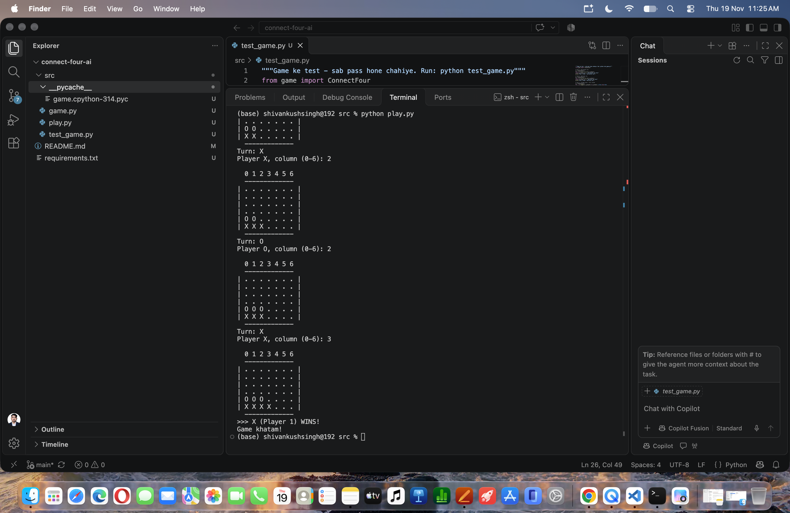

# Connect Four AI - AlphaZero Style

AI that learns Connect Four only by playing against itself, using the same idea DeepMind used for AlphaZero.

## Demo

2-Player game - X ne Horizontal XXXX se jeeta:



## How it Works (5 Phases)
- **Phase 1:** Game - board, legal moves, win check
- **Phase 2:** MCTS - Monte Carlo Tree Search, no neural network
- **Phase 3:** Policy/Value Network - predicts best move + win probability
- **Phase 4:** Self-Play Training - MCTS + Network play each other, network trains on results
- **Phase 5:** Test vs perfect solver

## How to Run
```bash
pip install -r requirements.txt
cd src
python play.py      # 2-Player game
python test_game.py # Game tests
```

## Files
- `src/game.py` - Connect Four board + win logic
- `src/play.py` - 2-Player game
- `src/test_game.py` - Game tests

## Results
- Phase 1: Game working, all tests pass
- Phase 2-5: Coming soon
